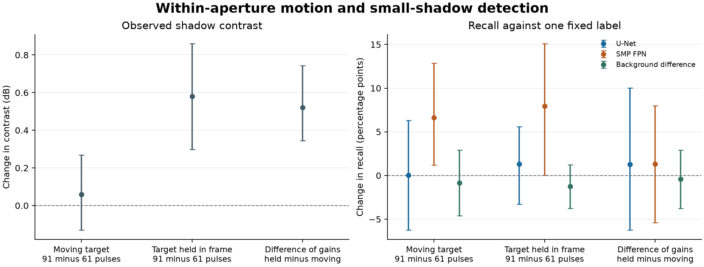

# 孔径内目标运动对小阴影成像与检测的影响

**孔径内运动削弱了长孔径带来的局部对比度收益。** 帧内固定后，61→91 脉冲的小阴影对比度增益多 **0.52 dB**，95% 区间为 **0.34 到 0.74 dB**。U-Net 的额外召回增益为 **1.27 个百分点**，区间为 **−6.25 到 +10.02 个百分点**。因此，预设的两项判据只满足成像对比度一项，U-Net 在长孔径下召回接近持平的原因仍待解释。

## 实验设置

复用独立孔径实验的 24 个场景族和主种子 101631，包括 12 个小目标、6 个正常目标及 6 个带静态暗区的无目标对照。固定 35 GHz、600 MHz、成像后 25 dB、5 ms 脉冲间隔和 0.25 m 地面网格。每个场景生成四个版本，共 96 段、1,920 帧。

| 因素 | 两档条件 |
|---|---|
| 合成孔径 | 61／91 脉冲，首末跨度 0.30／0.45 s |
| 帧内位置 | 逐脉冲使用原轨迹的位置／该帧全部脉冲使用帧中心时刻的位置 |

帧内固定组逐帧重新取轨迹位置。四条件共用帧中心几何、平台运动、散射背景、距离网格、观测平移和重叠脉冲的单位接收噪声。在同一孔径下，两种模式只改变目标参与遮挡计算的时刻。先核对数据，再沿用冻结的 U-Net、开源 SMP FPN 和背景差分。匹配阈值为目标级 IoU ≥ 0.50。[冻结协议](../../runs/aperture-motion-study/protocol.json) · [数据清单](../../runs/aperture-motion-study/dataset/manifest.csv)

小目标主分析采用四种条件都带可见标注的共同帧。所有方法以 **61 脉冲、逐脉冲移动**的真值轮廓统一评分。局部对比度取配准观察中几何遮挡外 2–5 像素环带与遮挡区内的中位功率比，并换算为 dB。先在每个场景族内求配对差，再按场景族等权重采样 2,000 次，得到 95% 百分位区间。

预先规定以“帧内固定组 61→91 的变化减去逐脉冲移动组的同一变化”为主要效应。小目标局部对比度与 U-Net 召回的这两个效应区间均高于零时，支持孔径内运动削弱长孔径收益。双 80% 用于报告检测性能。

48 段逐脉冲移动版的观察、几何掩膜、可见掩膜和无阻挡参考均与前次归档逐字节一致，144 个模型与差分的预测文件也一致。两档零速对照、12 对无目标对照与同孔径的噪声及参考核对均通过。全体信噪比偏差小于 0.1 dB。独立连通域复算核对 5,760 条各条件标签的逐帧检测结果、4,308 条固定轮廓的逐帧检测结果，以及 8 项局部对比度或召回的主要差值。[数据校验](../../runs/aperture-motion-study/dataset/validation.json) · [独立复算](../../runs/aperture-motion-study/prediction_audit.json)

## 四条件结果

| 脉冲与运动模式 | 小目标可见帧 | 小目标平均局部对比度 | 小目标 U-Net 召回 | SMP FPN 召回 | 背景差分召回 |
|---|---:|---:|---:|---:|---:|
| 61，逐脉冲移动 | 240/240 | 3.66 dB | 40.17% | 28.87% | 14.23% |
| 61，帧内固定 | 239/240 | 4.77 dB | 55.23% | 42.26% | 17.99% |
| 91，逐脉冲移动 | 240/240 | 3.72 dB | 40.17% | 35.56% | 13.39% |
| 91，帧内固定 | 239/240 | 5.35 dB | 56.49% | 50.21% | 16.74% |

表中平均对比度覆盖全部 240 个小目标几何遮挡帧。召回统一用四条件共同可见的 239 帧和固定轮廓。正常目标在四条件均可见，按各条件标签评分时，两种网络均达到查准率、召回率双 80%。小目标四档均未达到。每档有 120 帧无目标对照。61 脉冲下，U-Net／FPN／差分的虚警每帧为 0.083／0.058／0.283，91 脉冲下为 0.033／0.050／0.317。同孔径下两种模式的无目标结果一致。[成像统计](../../runs/aperture-motion-study/imaging_by_condition.csv) · [固定轮廓召回](../../runs/aperture-motion-study/fixed_label_recall.csv) · [条件检测统计](../../runs/aperture-motion-study/detection_by_condition.csv)

## 小目标配对证据

以下配对结果使用同一批 239 帧和 12 个场景族。由于各场景族等权，数值可与上表直接相减得到的逐帧汇总差略有不同。

| 比较 | 对比度变化（dB） | U-Net 召回变化（百分点） | FPN 召回变化（百分点） | 差分召回变化（百分点） |
|---|---:|---:|---:|---:|
| 逐脉冲移动，91 减 61 | +0.06 [−0.13, 0.27] | +0.02 [−6.25, 6.29] | +6.64 [1.21, 12.87] | −0.83 [−4.58, 2.92] |
| 帧内固定，91 减 61 | +0.58 [0.30, 0.86] | +1.29 [−3.29, 5.59] | +7.96 [0.04, 15.09] | −1.25 [−3.75, 1.25] |
| 两种模式的增益差 | **+0.52 [0.34, 0.74]** | **+1.27 [−6.25, 10.02]** | +1.32 [−5.42, 7.98] | −0.42 [−3.75, 2.92] |

同一孔径内，从逐脉冲移动切换到帧内固定，U-Net 的配对召回差为 **+14.98** 个百分点（61 脉冲）及 **+16.25** 个百分点（91 脉冲），两项区间均高于零。这说明孔径内运动与两档下较低的 U-Net 召回有关。两档受到的召回影响差异只有 1.27 个百分点，证据不足以解释延长孔径为何未明显提高 U-Net 召回。[分族配对](../../runs/aperture-motion-study/paired_by_family.csv) · [区间和同孔径对照](../../runs/aperture-motion-study/paired_summary.csv) · [逐帧预测结果](../../runs/aperture-motion-study/per_frame.csv)



结论适用于复用的场景族、35 GHz 载频、600 MHz 带宽、成像后 25 dB 和选定的两档孔径。帧内固定是逐帧重算遮挡的反事实对照。冻结检测结果包含原配准流程在各条件下的响应。

## 复现

在仓库根目录使用项目的 U-Net 环境。绘图使用 NumPy 和 Matplotlib ≥ 3.7。

```powershell
$env:OPENBLAS_NUM_THREADS = '1'
$env:OMP_NUM_THREADS = '4'
$run = 'runs\aperture-motion-study-repro'
.\.venv\Scripts\python.exe -m videosar aperture-motion-study --reference-run runs\aperture-study --output-dir $run
python deliverables\aperture-motion-study\plot_results.py $run "$run\motion-interaction.png"
```

`--reference-run` 用于核对既有孔径实验归档。省略该选项时，命令从主种子生成四种条件并执行内部配对及对照校验。

[完整证据包](../../runs/aperture-motion-study-evidence.zip)
