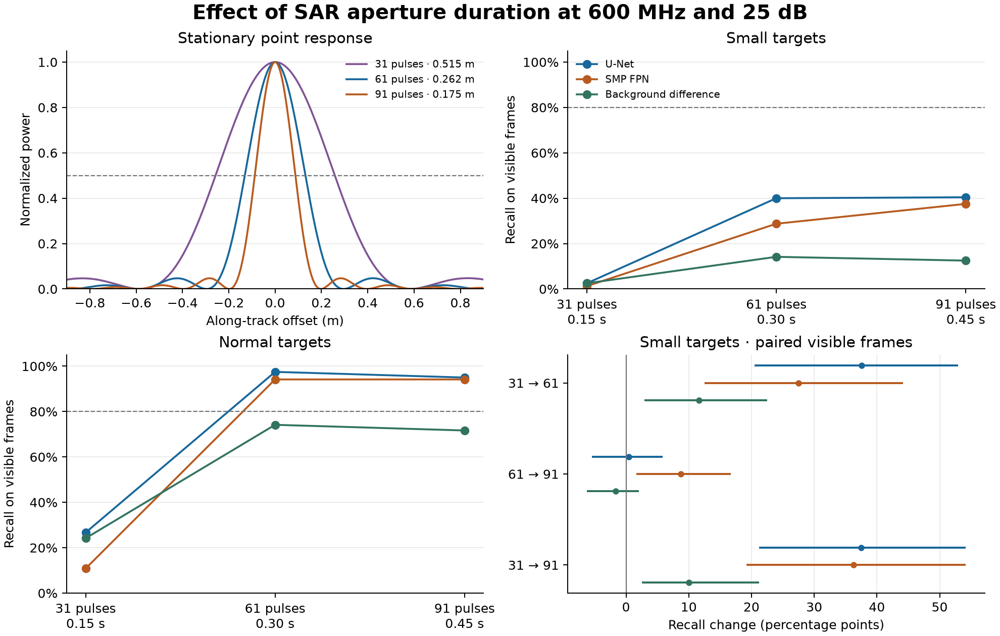

# 合成孔径长度对运动小阴影检测的影响

在 **600 MHz、成像后 25 dB** 的配对仿真中，31→61 脉冲改善了静止点目标的聚焦、运动小阴影的局部对比度和三种方法的召回。61→91 脉冲继续缩窄静止点主瓣，小目标召回增益主要出现在开源 SMP FPN。U-Net 的配对增益仅 **0.42 个百分点**，95% 区间为 **−5.42 到 +5.83 个百分点**。小目标三档均未达到双 80%。

## 实验与验收

使用主种子 101631 生成 24 个新场景族、72 段序列、1,440 帧。每族的三种孔径共用目标轨迹、平台、背景散射、静态暗区和帧间平移。12 个小目标场景族采用原尺寸规则的 60%，其中 6 个含静态暗区。另有 6 个正常目标和 6 个带静态暗区的无目标对照。各段 20 帧，帧间隔 0.2 s，64×80 地面网格，像素间距 0.25 m。

35 GHz 载频、600 MHz 带宽、5 ms 脉冲间隔和 2.4 m/s 平台速度固定。三档孔径绕每个帧中心对称取脉冲，共用距离采样网格。重叠的脉冲共用同一原始复高斯噪声样本，各档分别把成像后信噪比标定到 25 dB。61 与 91 脉冲的孔径跨度超过帧间隔，统计区间按场景族做 2,000 次重采样。

沿用上一轮冻结 U-Net、开源 SMP FPN 与背景差分、亚像素配准和 IoU ≥ 0.50 目标级匹配。复跑 `aperture-01` 的三种版本，观察、掩膜、参考和元数据哈希一致。72 段信噪比偏差均小于 0.1 dB。独立复算核对了 4,320 条逐帧检测结果、36 组条件汇总、27 项配对召回或虚警差和 18 项固定轮廓召回。[协议](../../runs/aperture-study/protocol.json) · [数据清单](../../runs/aperture-study/dataset/manifest.csv) · [数据验收](../../runs/aperture-study/dataset/validation.json) · [独立复算](../../runs/aperture-study/prediction_audit.json)

## 成像与检测结果

| 脉冲数／首末跨度 | 平台位移 | 点目标方位半功率宽度 | 小目标可见帧 | 小目标平均局部对比度 | 小目标可见面积 |
|---|---:|---:|---:|---:|---:|
| 31／0.15 s | 0.36 m | 0.515 m | 239/240 | 3.03 dB | 19.66 像素 |
| 61／0.30 s | 0.72 m | 0.262 m | 240/240 | 3.66 dB | 21.12 像素 |
| 91／0.45 s | 1.08 m | 0.175 m | 240/240 | 3.72 dB | 21.61 像素 |

三档的点目标二维聚焦峰值误差均为 0 像素，斜距半功率宽度均为 0.200 m。方位宽度用 2 mm 间隔的点响应剖面测量，检测仍在 0.25 m 地面网格上运行。局部对比度取配准后几何遮挡外 2–5 像素环带与遮挡内中位功率之比。可见面积按可见帧平均。[点目标核验](../../runs/aperture-study/point_checks.json) · [成像分组](../../runs/aperture-study/imaging_by_aperture.csv)

| 脉冲数 | 小目标 U-Net／FPN／背景差分召回 | 正常目标 U-Net／FPN／背景差分召回 | 无目标 U-Net／FPN／背景差分虚警每帧 |
|---:|---:|---:|---:|
| 31 | 2.51%／1.26%／2.51% | 26.67%／10.83%／24.17% | 0.017／0.008／5.575 |
| 61 | 40.00%／28.75%／14.17% | 97.50%／94.17%／74.17% | 0.083／0.058／0.283 |
| 91 | 40.42%／37.50%／12.50% | 95.00%／94.17%／71.67% | 0.033／0.050／0.317 |

61 和 91 脉冲的正常目标组，两种网络均达到查准率与召回率双 80%。计入小目标和无目标对照后，U-Net 在 61 和 91 脉冲的查准率／召回率分别为 79.18%／59.17% 和 77.86%／58.61%。每档无目标对照 120 帧。31 脉冲时，两种网络虚警低，正常和小目标召回也明显下降。[逐条件检测指标](../../runs/aperture-study/detection_by_aperture.csv)



## 小目标配对差

每项召回差只比较两档均有可见标注的同一帧。先求族内平均差，再将 12 个场景族等权平均。方括号为按场景族重采样的 95% 百分位区间。

| 脉冲变化 | 局部对比度（dB） | U-Net（百分点） | FPN（百分点） | 背景差分（百分点） |
|---|---:|---:|---:|---:|
| 31→61 | +0.63 [0.51, 0.76] | +37.52 [20.48, 52.94] | +27.52 [12.52, 44.19] | +11.67 [2.92, 22.51] |
| 61→91 | +0.06 [−0.14, 0.25] | +0.42 [−5.42, 5.83] | +8.75 [1.67, 16.67] | −1.67 [−6.25, 2.08] |
| 31→91 | +0.69 [0.46, 0.91] | +37.50 [21.25, 54.17] | +36.25 [19.17, 54.17] | +10.00 [2.50, 21.25] |

将三个孔径的预测统一对照 61 脉冲的真值，在三档均可见的 239 个小目标帧上，61→91 的 U-Net 召回由 **40.17% 到 39.75%**，FPN 由 **28.87% 到 35.56%**。固定轮廓后，U-Net 仍近乎持平，FPN 仍改善。逐帧筛出 21 条局部对比度大于零、背景差分匹配且至少一种网络漏检的场景／帧／孔径记录。[配对区间](../../runs/aperture-study/paired_summary.csv) · [固定轮廓结果](../../runs/aperture-study/fixed_label_recall.csv) · [漏检案例](../../runs/aperture-study/mismatch_cases.csv)

## 适用边界

61→91 脉冲的静止点主瓣再窄约 33%，小目标平均局部对比度只提高 0.06 dB，冻结方法的召回表现出现分化。结果覆盖当前三档孔径、单一带宽与信噪比、固定平台速度，以及测试中的运动和目标尺寸。延长孔径同时改变方位响应、孔径内运动造成的遮挡覆盖和成像纹理。实验识别的是孔径设置的整体影响，尚无法量化这些机制各自的贡献，也未覆盖实测。

后续实验通过帧内固定目标，单独检验了孔径内运动对小阴影对比度和召回的影响。[孔径内目标运动对照](../aperture-motion-study/report.md)

## 复现

在仓库根目录沿用项目的 U-Net 环境。绘图使用 NumPy 和 Matplotlib ≥ 3.7。

```powershell
$env:OPENBLAS_NUM_THREADS = '1'
$env:OMP_NUM_THREADS = '4'
$run = 'runs\aperture-study-repro'
.\.venv\Scripts\python.exe -m videosar aperture-study --output-dir $run
python deliverables\aperture-study\plot_results.py $run "$run\aperture-results.png"
```

[完整证据包](../../runs/aperture-study-evidence.zip)
