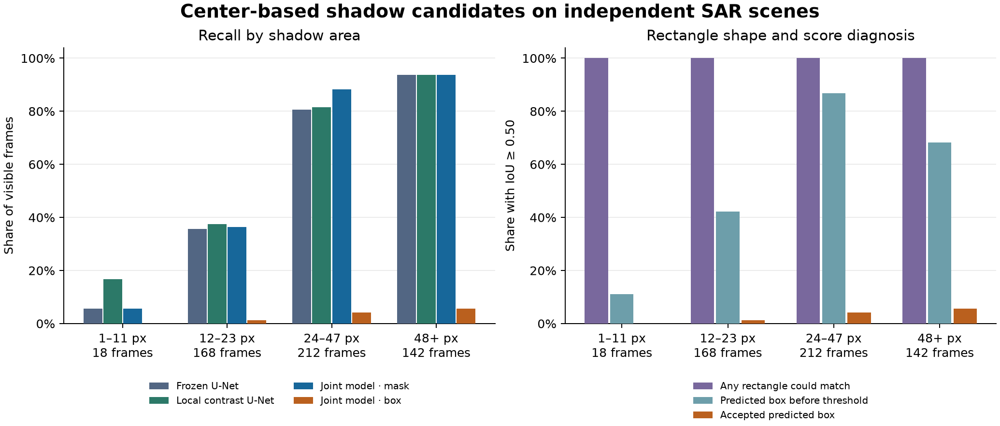

# 小阴影中心候选框与分割对照

**直接中心候选框未通过验收。** 在 36 段独立测试上，使用冻结阈值的直接候选小目标召回为 **3.06%**。同一联合模型的分割输出达到 **59.17%**，比等预算局部对比度 U-Net 高 **1.67 个百分点**，95% 区间为 **−3.89 到 +7.22 个百分点**。

## 实验设计

上一轮局部对比度 U-Net 的 185 次漏检中，184 次在固定概率阈值后已缺少满足 IoU ≥ 0.50 的候选。本轮检验直接学习小阴影的中心和四条边，能否改善候选匹配。[上一轮诊断](../contrast-study/report.md)

直接从中心点回归候选框的思路来自 CenterNet，按像素位置预测四边距离参考 FCOS。本轮在项目已有的 SMP U-Net 解码器中增加中心及四边输出，保留单通道分割输出。中心标签取可见掩膜外接框的整数中心，热图使用标准差 1 像素的高斯标注。四边距离在真值中心以 `log1p` 参数化。联合损失为原分割 BCE＋Dice、中心焦点损失及权重 0.25 的四边 Smooth L1 损失。直接候选每帧取热图最高点及其四边距离，达到验证阈值时输出一个矩形。该设计适用于本轮每帧至多一个目标的设定。[CenterNet 论文](https://arxiv.org/abs/1904.07850) · [原项目](https://github.com/xingyizhou/CenterNet) · [FCOS 论文](https://arxiv.org/abs/1904.01355) · [SMP 项目](https://github.com/qubvel-org/segmentation_models.pytorch)

复用局部对比度实验的 48 段训练和 24 段验证。联合模型与已训练的局部对比度对照使用相同初始化权重、四通道输入、训练数据、随机种子和六轮预算。中心和边界从新增权重学习。两项候选分别使用同一联合检查点的分割和直接候选框输出，按验证集独立冻结阈值。另保留冻结原网格 U-Net、开源 SMP FPN 和背景差分。[冻结协议](../../runs/center-study/protocol.json) · [验证冻结记录](../../runs/center-study/frozen_validation.json)

使用主种子 101651 生成 36 段全新纯回波测试序列，共 720 帧。18 段小目标、9 段正常目标、9 段无目标。固定 600 MHz、成像后 25 dB、0.25 m 像素间隔，61／91 脉冲各占一半。所有方法在 64×80 原网格以目标级 IoU ≥0.50 匹配。采用条件为总体查准率和召回均达到 80%，相对冻结 U-Net 的小目标召回提升至少 10 个百分点，正常目标召回下降不超过 5 个百分点。[测试数据清单](../../runs/center-study/dataset/manifest.csv)

## 锁定测试结果

| 方法 | 查准率 | 召回率 | 目标级 F1 | 小目标召回 | 正常目标召回 | 无目标虚警／帧 |
|---|---:|---:|---:|---:|---:|---:|
| 冻结 U-Net | 76.84% | 67.59% | 71.92% | 55.56% | 91.67% | 0.094 |
| 等预算局部对比度 U-Net | 78.48% | 68.89% | 73.37% | 57.50% | 91.67% | 0.078 |
| 冻结开源 SMP FPN | 76.04% | 64.07% | 69.55% | 51.11% | 90.00% | 0.067 |
| 冻结背景差分 | 35.29% | 28.89% | 31.77% | 9.44% | 67.78% | 0.289 |
| 联合模型／分割 | 77.02% | **70.74%** | **73.75%** | **59.17%** | **93.89%** | 0.122 |
| 联合模型／中心框 | 79.17% | 3.52% | 6.74% | 3.06% | 4.44% | 0.000 |

验证集选择了联合模型第 3 轮检查点，并优先选择分割输出。分割阈值／最小连通域为 0.10／12，直接中心框阈值为 0.55，每帧至多输出一框。联合分割比等预算模型多匹配 6 个小目标。按可见面积分组，24–47 像素多匹配 14 帧，小于 24 像素少匹配 4 帧，至少 48 像素的匹配帧数持平。两项候选均未满足采用条件。区间按独立场景配对重采样 2,000 次。[分组结果](../../runs/center-study/metrics_by_group.csv) · [按面积分组](../../runs/center-study/recall_by_shadow_area.csv) · [配对区间](../../runs/center-study/paired_summary.csv)

## 直接候选框的诊断

| 支持情况 | 全部可见帧 | 小目标可见帧 |
|---|---:|---:|
| 可见帧总数 | 540 | 360 |
| 真值外接矩形达到 IoU ≥0.50 | 540 | 360 |
| 模型最高分矩形在阈值前达到 IoU ≥0.50 | 354 | 225 |
| 达到冻结阈值且矩形匹配 | 19 | 11 |

本批真值均可用轴对齐矩形达到 IoU 门槛。直接候选在小目标中有 135 帧的最高分矩形位置或尺寸不够准，另有 214 帧的匹配框未通过冻结阈值。若对所有 720 帧强制输出最高分框，召回为 65.56%，查准率为 49.17%。验证集的中心框扫描也体现了这一取舍：以 F1 排名最高的 0.20 阈值对应 68.19% 查准率与 66.11% 召回，所有扫描点均未达到双 80%。这些结果限定在当前单目标仿真和固定训练预算。[逐帧框诊断](../../runs/center-study/box_diagnostics.csv) · [验证阈值扫描](../../runs/center-study/validation_center_box.csv)



## 复现

从仓库根目录使用现有 U-Net 环境。第一个命令读取上一轮已冻结的训练与验证归档，绘图另需 NumPy 和 Matplotlib ≥3.7。

```powershell
$env:OPENBLAS_NUM_THREADS = '1'
$env:OMP_NUM_THREADS = '4'
$run = 'runs\center-study-repro'
.\.venv\Scripts\python.exe -m videosar center-study --training-run runs\contrast-study --output-dir $run
python deliverables\center-study\plot_results.py $run "$run\center-results.png"
```

两种候选均可用现有 `detect --method learned --model` 入口调用，配置共享同一个权重文件。36 段数据哈希、4,320 条逐帧检测、540 帧外接矩形核对和 15 项配对差均已独立复算。两种命令行输出与存档预测逐字节一致，23 项自动测试通过。[中心框配置](models/center_box.json) · [联合分割配置](models/joint_mask.json) · [独立复算](../../runs/center-study/prediction_audit.json) · [完整证据包](../../runs/center-study-evidence.zip)
