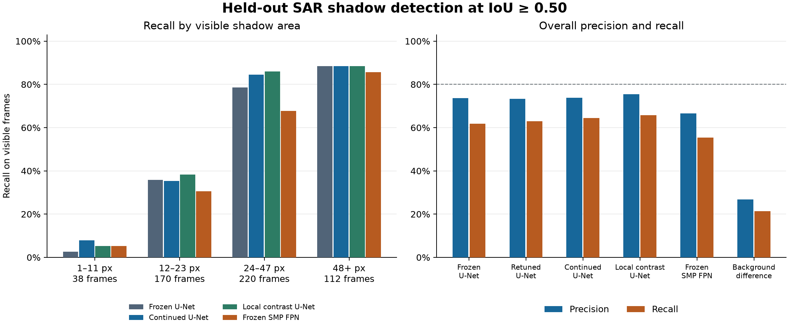

# 面向小阴影的多尺度局部对比度实验

局部对比度 U-Net 在锁定测试上的小目标召回为 **55.00%**，高于冻结 U-Net 的 **50.56%**。与等预算续训相比，局部特征额外增加 **1.67 个百分点**，按场景重采样的 95% 区间为 **−0.28 到 +3.89 个百分点**。三种候选均未达到采用条件。

## 实验设计

上一轮时序实验的原网格微调 U-Net 漏检中，87.5% 发生在可见标注小于 24 像素的阴影。本轮以两个空间尺度显式提供暗中心线索，检验它能否在相同训练数据和预算下增加小阴影召回。[此前的面积诊断](../temporal-study/report.md)

使用主种子 101641 生成 108 个独立纯回波场景，2,160 帧。训练、验证和锁定测试按场景划分为 48、24、36 段。各划分均衡覆盖 61／91 脉冲，固定 600 MHz、成像后 25 dB、0.25 m 像素间隔和真实逐脉冲目标运动。每个划分的一半为小目标，其中一半叠加慢速和静态暗区，另有正常目标与含静态暗区的无目标对照。[冻结协议](../../runs/contrast-study/protocol.json) · [数据清单](../../runs/contrast-study/dataset/manifest.csv)

新通道以每个像素为中心，在配准帧的 `log1p` 功率上，计算正方形外环平均值减去中心窗平均值。中心窗／外窗边长分别为 3／9、5／15 像素。两条通道各自的均值和标准差由训练集估计。原有当前帧和相邻帧差分通道沿用初始化权重的归一化。新增卷积权重从零开始。续训组和局部对比度组使用相同场景、初始化、BCE＋Dice 损失、随机种子和 6 轮训练预算，按验证损失选择检查点。

冻结 U-Net、开源 SMP FPN 和背景差分复用既有操作点。重选操作点组只扫描冻结 U-Net 的阈值和连通域面积。它与两组续训候选共用验证扫描网格。评测在原始 64×80 网格进行，以目标级 IoU ≥ 0.50 匹配。采用条件为总体查准率和召回率均 ≥80%，小目标召回较冻结 U-Net 提高至少 10 个百分点，正常目标召回最多下降 5 个百分点。[SMP 项目](https://github.com/qubvel-org/segmentation_models.pytorch)

## 锁定测试结果

测试有 36 段、720 帧，其中 540 帧有可见目标，360 帧来自小目标场景。验证集优先选中仅重选操作点的候选，其概率阈值为 0.70。两个续训候选均选到 0.50，两者的最佳验证损失均出现在第 4 轮。三个候选均采用 8 像素最小连通域和闭运算。[验证冻结记录](../../runs/contrast-study/frozen_validation.json)

| 方法 | 总体查准率 | 总体召回 | 目标级 F1 | 小目标召回 | 正常目标召回 | 无目标虚警／帧 |
|---|---:|---:|---:|---:|---:|---:|
| 冻结 U-Net | 73.73% | 61.85% | 67.27% | 50.56% | 84.44% | 0.161 |
| 仅重选操作点 | 73.28% | 62.96% | 67.73% | 52.78% | 83.33% | 0.178 |
| 等预算续训 U-Net | 73.89% | 64.44% | 68.84% | 53.33% | 86.67% | 0.111 |
| 局部对比度 U-Net | **75.53%** | **65.74%** | **70.30%** | **55.00%** | **87.22%** | 0.117 |
| 冻结开源 SMP FPN | 66.59% | 55.37% | 60.47% | 44.44% | 77.22% | 0.150 |
| 冻结背景差分 | 26.74% | 21.30% | 23.71% | 4.44% | 55.00% | 0.350 |

局部对比度版比等预算续训多匹配 6 个小目标，且两者采用相同操作点。两档孔径下的召回差分别为 +1.11 和 +2.22 个百分点。相较冻结 U-Net，局部对比度版多匹配 16 个小目标，召回差为 +4.44 个百分点，95% 区间为 −0.56 到 +9.17 个百分点。两个区间均跨零，增益的稳定性仍待验证。区间以独立场景成对重采样 2,000 次，每次按抽中序列的匹配和可见帧总数计算召回差。[分组检测结果](../../runs/contrast-study/metrics_by_group.csv) · [分孔径结果](../../runs/contrast-study/metrics_by_aperture.csv) · [配对区间](../../runs/contrast-study/paired_summary.csv)

## 最小阴影仍是主要短板

| 可见阴影面积 | 帧数 | 冻结 U-Net | 等预算续训 | 局部对比度 |
|---|---:|---:|---:|---:|
| 1–11 像素 | 38 | 2.63% | 7.89% | 5.26% |
| 12–23 像素 | 170 | 35.88% | 35.29% | 38.24% |
| 24–47 像素 | 220 | 78.64% | 84.55% | 85.91% |
| 48 像素及以上 | 112 | 88.39% | 88.39% | 88.39% |

局部对比度版漏检的 185 帧中，184 帧在固定概率阈值后已缺少 IoU ≥ 0.50 的候选，另 1 帧在闭运算后失配。两帧 3 像素阴影受 8 像素最小连通域限制，最终最大可能 IoU 为 3/8。按面积分组和逐阶段复算说明，最小阴影在原始分割阶段仍普遍缺少达标候选。[面积分组](../../runs/contrast-study/recall_by_shadow_area.csv) · [漏检阶段](../../runs/contrast-study/misses_by_stage_and_area.csv)



## 复现

在项目根目录沿用 U-Net 环境。绘图另需 NumPy 和 Matplotlib ≥ 3.7。

```powershell
$env:OPENBLAS_NUM_THREADS = '1'
$env:OMP_NUM_THREADS = '4'
$run = 'runs\contrast-study-repro'
.\.venv\Scripts\python.exe -m videosar contrast-study --output-dir $run
python deliverables\contrast-study\plot_results.py $run "$run\contrast-results.png"
```

通过现有 `detect --method learned --model` 入口调用候选配置。新配置在锁定序列的部署预测已与实验存档逐字节比对；旧配置也复现了既有预测。108 段数据哈希、4,320 条逐帧检测和 15 项场景配对差已独立复算，21 项自动测试通过。结果适用于本轮 600 MHz、25 dB、61／91 脉冲的纯回波仿真。[局部对比度配置](models/local_contrast.json) · [续训对照配置](models/continued.json) · [独立核对](../../runs/contrast-study/prediction_audit.json) · [完整证据包](../../runs/contrast-study-evidence.zip)
