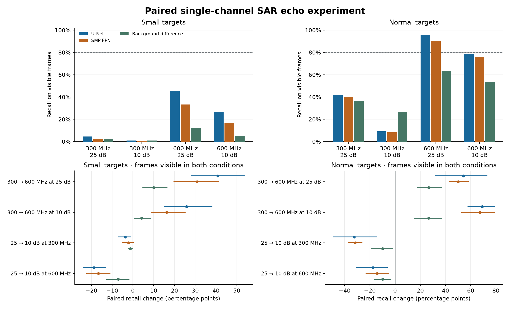
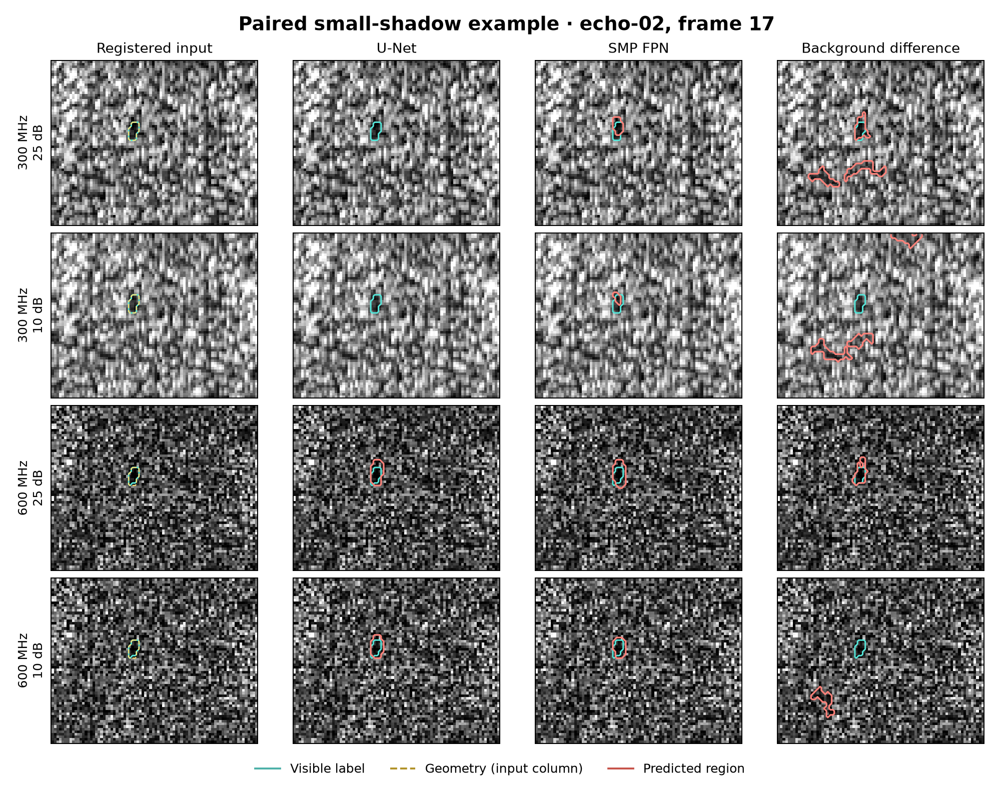

# 小阴影漏检归因｜配对单通道 SAR 回波实验

**本轮研究验收完成。** 提高带宽和降低接收噪声都改善了小阴影的检测表现。600 MHz、25 dB 是四种条件中表现最好的一档，小目标的 U-Net 和开源 SMP FPN 召回仍只有 45.42% 和 33.33%。两种网络在部分仍有明显对比度、背景差分能够匹配的样本上漏检。总体双 80% 性能目标尚未达到。

## 实验与校验

| 项目 | 设置 |
|---|---|
| 场景 | 主种子 101621，24 个独立场景族、96 段、1,920 帧。12 个小目标场景族采用原尺寸规则的 60%，其中 6 个带静态暗区，另有 6 个正常目标和 6 个带静态暗区的无目标对照 |
| 成像 | 35 GHz，300 或 600 MHz 带宽，25 或 10 dB 成像后信噪比。每帧 61 脉冲，脉冲间隔 5 ms。每段 20 帧，帧间隔 0.2 s，64×80 地面网格，像素间距 0.25 m |
| 配对 | 族内固定目标轨迹、平台与孔径、静态暗区、复散射体实现和观测平移。同带宽下两档信噪比共用接收噪声实现，仅调整幅度 |
| 检测 | 复用相同配准与冻结设置。U-Net 阈值 0.30、最小面积 12 px、闭运算开启。SMP FPN 阈值 0.70、最小面积 8 px、闭运算开启。背景差分阈值 0.35、最小面积 32 px、闭运算关闭 |
| 目标级评价 | 四连通域，最佳区域 IoU ≥ 0.50 记为匹配。每帧最多匹配一个区域，其余预测区域计为虚警 |

接收端的复高斯噪声单独经过距离压缩和反投影，再与洁净复图像相加并取模平方。成像后信噪比按同一序列的无阻挡洁净平均功率与成像噪声平均功率之比定义，额外图像域扰动关闭。点目标斜距响应半功率宽度由 0.400 m 减至 0.200 m，峰值误差均为 0 像素。全部序列信噪比偏差小于 0.1 dB。已复跑一个完整场景族，四种条件的输入与标签哈希一致。独立脚本从保存的预测和真值复算了 5,760 个逐帧检测结果、48 组条件汇总和 45 项配对召回或虚警差。[冻结协议](../../runs/echo-attribution/protocol.json) · [数据清单](../../runs/echo-attribution/dataset/manifest.csv) · [点目标检查](../../runs/echo-attribution/point_checks.json) · [独立核对](../../runs/echo-attribution/prediction_audit.json)

## 四条件结果

| 带宽 | 信噪比 | 小目标平均局部对比度 | 小目标平均可见掩膜面积 | 小目标召回 U-Net / FPN / 差分 | 正常目标召回 U-Net / FPN / 差分 |
|---:|---:|---:|---:|---:|---:|
| 300 MHz | 25 dB | 3.20 dB | 18.99 px | 4.58% / 2.50% / 2.08% | 41.67% / 40.00% / 36.67% |
| 300 MHz | 10 dB | 2.54 dB | 18.99 px | 0.83% / 0.42% / 0.83% | 9.17% / 8.33% / 26.67% |
| 600 MHz | 25 dB | 3.93 dB | 20.53 px | 45.42% / 33.33% / 12.08% | 95.83% / 90.00% / 63.33% |
| 600 MHz | 10 dB | 3.30 dB | 20.53 px | 26.67% / 16.67% / 5.00% | 78.33% / 75.83% / 53.33% |

每种条件中，小目标 240/240 帧、正常目标 120/120 帧均达到成像可见标注条件。标注使用无噪声反事实功率和孔径遮挡覆盖，同带宽下两档噪声的掩膜一致。噪声对实际检测输入的影响以配准后局部对比度衡量，取几何遮挡外 2–5 像素环带与遮挡内的中位功率之比，再转换为 dB。[成像明细](../../runs/echo-attribution/imaging_by_condition.csv)

600 MHz、25 dB 的正常目标组中，U-Net 的查准率／召回率为 **96.64%／95.83%**，FPN 为 **90.76%／90.00%**，均达到双 80%。该条件计入小目标和无目标对照后，U-Net 为 **79.43%／62.22%**，FPN 为 **71.21%／52.22%**。汇总四条件，U-Net 为 71.59%／31.67%，FPN 为 61.44%／26.67%，背景差分为 5.95%／18.33%。[分组查准率和召回](../../runs/echo-attribution/detection_by_condition.csv) · [全量汇总](../../runs/echo-attribution/metrics.csv)

| 无目标对照 | U-Net 虚警数／帧 | FPN 虚警数／帧 | 背景差分虚警数／帧 |
|---|---:|---:|---:|
| 300 MHz、25 dB | 0.000 | 0.000 | 2.958 |
| 300 MHz、10 dB | 0.000 | 0.000 | 4.183 |
| 600 MHz、25 dB | 0.058 | 0.058 | 0.392 |
| 600 MHz、10 dB | 0.050 | 0.033 | 0.750 |

每种条件有 120 帧无目标对照。300 MHz 条件下，两种网络的正常目标召回也大幅下降，两档零虚警需结合召回一起读。



## 成像条件与模型失配各有哪些证据

配对召回仅比较两种条件下都带成像可见标注的同一帧。本轮小目标的每项比较均覆盖同一批 240 帧，来自 12 个独立场景族。先在族内求平均差，再对各族等权平均。方括号给出按场景族 2,000 次重采样的 95% 百分位区间。

| 小目标配对比较 | 观测对比度变化（dB） | U-Net 召回变化（百分点） | FPN 召回变化（百分点） | 差分召回变化（百分点） |
|---|---:|---:|---:|---:|
| 25 dB，300 → 600 MHz | +0.73 [0.55, 0.94] | +40.83 [27.92, 53.75] | +30.83 [19.57, 41.67] | +10.00 [4.57, 16.67] |
| 10 dB，300 → 600 MHz | +0.76 [0.60, 0.91] | +25.83 [15.00, 38.33] | +16.25 [8.75, 25.42] | +4.17 [0.42, 8.75] |
| 300 MHz，25 → 10 dB | −0.66 [−0.79, −0.54] | −3.75 [−7.08, −0.83] | −2.08 [−5.42, 0.42] | −1.25 [−2.50, 0.00] |
| 600 MHz，25 → 10 dB | −0.62 [−0.80, −0.46] | −18.75 [−24.17, −12.92] | −16.67 [−22.50, −10.83] | −7.08 [−12.92, −1.67] |

- **带宽有明确影响。** 两档信噪比下，扩大带宽均提升阴影局部对比度和三种方法的召回。主分析对每档带宽使用各自的可见标注。补充核对把同一帧的真值固定在 300 或 600 MHz 的轮廓，25 dB 下 U-Net 的召回增益仍为 **37.08–40.83 个百分点**，FPN 为 **27.50–30.42 个百分点**。10 dB 下采用任一固定轮廓，三种方法的带宽增益方向均保持。[分族配对](../../runs/echo-attribution/paired_by_family.csv) · [配对区间及交互项](../../runs/echo-attribution/paired_summary.csv) · [固定轮廓核对](../../runs/echo-attribution/fixed_label_sensitivity.csv)
- **噪声加重了可见阴影的检测退化。** 600 MHz 下，信噪比由 25 dB 降至 10 dB 时，三种方法的召回同时下降。300 MHz 的小目标召回已接近零，FPN 和差分的额外降幅区间包含零。两档噪声下的局部对比度降幅相近，召回降幅随带宽改变。
- **冻结网络在部分可检测帧上仍失配。** 筛出 22 条场景、帧与条件组合，覆盖 7 个小目标场景族的 18 个帧位置。它们在四档条件均有可见标签，当前条件对比度大于 0 dB，背景差分达到 IoU 门槛且至少一个网络漏检。其中两种网络同时漏检 10 条。以 `echo-02` 第 17 帧为例，600 MHz、25 dB 下局部对比度 9.09 dB，背景差分最佳区域 IoU 为 0.618，U-Net 与 FPN 分别为 0.465、0.396。四条件小目标漏检中，U-Net 有 762/774 次、FPN 有 832/833 次在冻结阈值输出时已缺少达标候选。[案例清单](../../runs/echo-attribution/mismatch_cases.csv) · [逐帧结果](../../runs/echo-attribution/per_frame.csv)



## 适用范围

已观察到的双 80% 通过范围为 **600 MHz、25 dB 的正常目标组**。本文小目标每档的平均可见掩膜约 19–21 像素，四档均未通过。结论覆盖本实验的两档带宽、两档全序列信噪比、固定地面网格和 61 脉冲孔径。正常目标组仅 6 个独立场景族。100% 的成像可见率采用洁净标注定义，在有噪图上仍可能难以分辨。同帧差分对照和阈值诊断支持部分模型失配，但不足以量化全部漏检中成像与模型各占多少。带宽切换同时改变距离响应、成像纹理和采样率。本轮证据支持整个带宽设置的效应。带宽与信噪比的连续阈值及实测适用性尚待验证。后续实验独立比较了三档孔径。[孔径配对实验](../aperture-study/report.md)

## 复现

在项目根目录使用 Windows PowerShell。主实验沿用 README 的 U-Net 环境，并从仓库现有交付目录读取冻结权重。绘图另需 NumPy 和 Matplotlib ≥ 3.7。

```powershell
$env:OPENBLAS_NUM_THREADS = '1'
$env:OMP_NUM_THREADS = '4'
$py = '.\.venv\Scripts\python.exe'
$run = 'runs\echo-attribution-repro'
& $py -m videosar echo-attribution --output-dir $run
& $py deliverables\echo-attribution\audit_results.py $run
python deliverables\echo-attribution\plot_results.py $run "$run\figures"
```

[完整证据包](../../runs/echo-attribution-evidence.zip)
