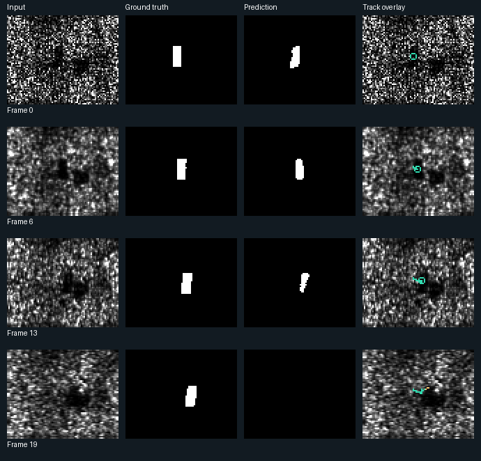

# 按申报书开展的阴影仿真与检测实验

在预先固定的 24 段独立仿真测试序列上，采用时序输入、训练噪声增强和形态学后处理的 U-Net 取得 **96.05% 查准率、97.25% 召回率、96.65% 目标级 F1**。目标级 F1 比最佳传统基线高 **26.3 个百分点**。按本实验的仿真与评测范围，达到申报书的数字目标。

## 数据与划分

正式数据集含 **120 段独立序列、2,400 帧**，每段 20 帧、64×80 像素。80 段使用图像域几何遮挡与背景衰减，40 段经过复基带回波仿真、距离压缩及反投影。每段保存非负功率、阴影评估掩膜、几何掩膜、时间戳、轨迹参数及随机种子。用场景与轨迹分组后，训练、验证和测试各有 72、24 和 24 段。每段数组和元数据都在清单中登记 SHA-256。

训练覆盖均匀、纹理及低散射杂波三类背景。测试另外包含六段训练中未出现的道路背景，三个划分均包含慢、中、快三档运动及无目标场景。模拟接收热噪声、强度扰动以及亚像素帧间平移。平移只施加到观察帧，标签保存在固定的地面坐标系。配准算法以首帧为参考，使用相位相关从观察值估计偏移。真实偏移仅用于配准误差核对。SAR 仿真标签以孔径覆盖和无噪声反事实图像的局部强度下降定义。

## 检测方法与评测口径

两类传统基线是低灰度阈值与形态学筛选，以及背景差分与连通域筛选。神经网络复用 Segmentation Models PyTorch 0.5.0 的 U-Net，使用包含三个下采样阶段的 ResNet-18 编码器和轻量解码器，输出逐像素阴影概率。单帧输入为当前帧对数功率，时序输入增加当前帧与上一帧的对数功率差。两者采用相同的训练配置，以加权二元交叉熵和 Dice 联合优化。归一化统计量仅来自训练集。训练噪声增强在时序模型上单独比较，后处理在同一时序增强权重及阈值上比较。

训练通过验证损失选择检查点，检测阈值和区域过滤按验证集目标级 F1 选择。固定后才运行测试。对每个可见阴影实例，预测的四连通区域与真值掩膜的 IoU 达到 0.50 才计为匹配。同帧最多匹配一个区域，其余预测区域计为虚警。单帧耗时按同机器、同帧尺寸计算，含配准、评分和掩膜后处理，跟踪耗时另属于下游处理。申报书目标为查准率与召回率均达到 80%，并争取比最佳传统基线提高至少 5 个百分点的目标级 F1。

## 结果与消融

测试共 480 帧，含 400 个可见阴影实例。下表合并 16 段图像域和 8 段回波成像序列。单帧耗时为本机 CPU 的批量处理总耗时除以帧数。

| 方法 | 查准率 | 召回率 | 目标级 F1 | 像素 F1 | 区域 IoU | 虚警/帧 | 毫秒/帧 |
|---|---:|---:|---:|---:|---:|---:|---:|
| 低灰度阈值＋形态学 | 43.3% | 68.3% | 53.0% | 0.504 | 0.337 | 0.744 | 0.77 |
| 背景差分＋连通域 | 74.0% | 67.0% | 70.3% | 0.699 | 0.538 | 0.196 | 0.69 |
| 单帧 U-Net | 84.4% | 94.5% | 89.2% | 0.893 | 0.807 | 0.146 | 2.23 |
| 时序 U-Net | 90.5% | 97.5% | 93.9% | 0.913 | 0.839 | 0.085 | 2.29 |
| 时序 U-Net＋训练噪声增强 | 88.4% | 97.25% | 92.6% | 0.908 | 0.831 | 0.106 | 2.33 |
| 时序 U-Net＋训练噪声增强＋后处理 | **96.05%** | 97.25% | **96.65%** | 0.910 | 0.836 | **0.033** | 2.48 |

- **加入相邻帧差分**后，目标级 F1 提高 4.7 个百分点，虚警区域从 70 个降到 41 个，召回率从 94.5% 升至 97.5%。
- **加入训练噪声增强**后，高噪声组目标级 F1 从 93.3% 升至 94.2%，总体 F1 从 93.9% 降至 92.6%。收益随噪声条件变化。
- **加入形态学闭运算和小区域过滤**后，同一模型、同一阈值下虚警从 51 个降至 16 个，匹配数保持 389 个。选择的阈值为 0.83，最小连通域面积为 24 像素。

最终配置在图像域子集的查准率和召回率分别为 **99.4% 和 98.4%**，在回波成像子集分别为 **84.1% 和 92.5%**。六段未见道路背景的目标级 F1 为 **97.0%**。在四段无目标序列中仍有七个虚警区域。九段有配准扰动的测试序列，帧平移估计误差从未校正的 **1.29 像素**降至 **0.36 像素**，按二维位移误差的均方根计算。上述指标适用于本次独立仿真划分与单目标任务。

## 复现与来源

[运行指南](../../README.md) · [冻结数据清单](dataset.json) · [逐场景标签统计](labels_by_scene.csv) · [验证集冻结记录](frozen_validation.json) · [指标总表](metrics.csv) · [逐组指标](metrics_by_group.csv) · [部署配置](models/unet_temporal_post.json)

另一次独立生成复现了全部 120 段序列的文件哈希。本机通过 11 项自动测试。训练使用 PyTorch 2.7.1 CPU 版，最多 16 轮，检测通过打包模型的命令行入口验证。

复用的框架包括 [Segmentation Models PyTorch](https://github.com/qubvel-org/segmentation_models.pytorch) 的 U-Net 和 [scikit-image 亚像素平移配准](https://scikit-image.org/docs/stable/api/skimage.registration.html#skimage.registration.phase_cross_correlation)。项目路线与验收口径来自已填写的《天元实验室本科生创新基金项目申报书》。
