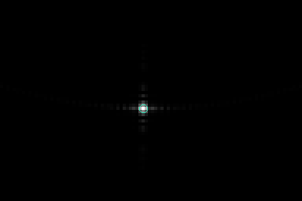
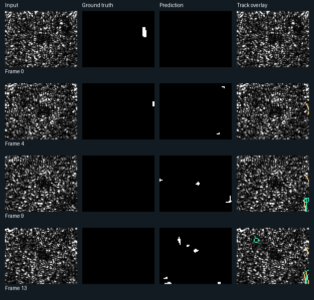

# Ka 频段视频 SAR 阴影建模与检测仿真报告

**2026-11-19 · 仿真交付**

## 1. 实验问题和主要结果

本项目验证一条从运动物体遮挡、单通道 SAR 成像到阴影检测与表观速度估计的可复现流程。在固定种子的 9 段独立测试序列上，因果时序模型取得最高像素 IoU（0.286），单帧模型取得最低轨迹位置均方根误差（13.12 px）和最低平均阴影速度向量误差（1.47 m/s）。强杂波、出画和无目标测试仍出现大量误检。当前结果支持复现实验和对比方法，现场性能待实测验证。

## 2. 模型与数据

**图像域。** 平坦地面上的散射单元连接雷达相位中心。视线在物体顶面以下与矩形棱柱相交时，对该地面单元施加强度衰减。背景包含空间纹理、固定低反射区域和随机强度扰动。

**成像域。** 默认合成场景使用 35 GHz 载频、600 MHz 带宽和 0.25 m 地面采样。按双程距离计算复基带相位和时延，脉冲为线性调频信号。模拟回波经匹配滤波完成距离压缩，再按脉冲位置反投影并相干累加。每帧使用 41 个脉冲，间隔 5 ms。遮挡随慢时间更新，以强度衰减的平方根调整回波振幅。散斑由复数地面散射场产生，额外噪声在聚焦之后作为乘性强度扰动加入。

**标签。** 几何掩膜取帧中心时刻的视线遮挡。成像可见阴影要求单元在至少一半孔径脉冲内被遮挡，且无额外噪声的局部功率低于无阻挡参考的 75%。无阻挡参考用于生成标签及分析。该定义给出可复现实验标签，边界取决于孔径、散斑和功率阈值。

**划分。** 数据种子 42 生成 30 段序列，按独立场景及轨迹族划分为 15 段训练、6 段验证、9 段测试，每段 14 帧。测试共 126 帧，其中 95 帧含可见阴影。训练集提供特征归一化参数，验证集确定 4 种方法各自的像素阈值。测试条件包括纹理背景、静态暗区、无目标、小尺寸快速运动、高噪声和出画。测试集每个条件只有 1–2 段，各条件也存在成像来源等差异，分组数据用于定位失效场景。

## 3. 成像与回归验收

| 校验 | 实际结果 |
|---|---:|
| 35 GHz 默认配置的距离峰误差 | 0.441 采样格，约 0.055 m |
| 双程时延误差 | 0.367 ns |
| 聚焦点目标峰位误差 | 0 px，峰值位于 `(y=34, x=45)` |
| 半功率主瓣宽度（600 / 300 MHz） | 0.200 / 0.400 m |
| 24 帧矩形基准 | 每帧 512 个真值像素，检测匹配 24 帧，IoU 0.992 |
| 矩形基准表观速度 | `(30, 5)` px/s |
| 默认 SAR 演示的时序模型检测 | IoU 0.239，24 帧中匹配 21 帧，另有 173 个误检连通域 |

点目标校验验证默认配置下的采样距离和聚焦峰位置。主瓣宽度来自离散调频脉冲的匹配滤波响应。单个点校验未覆盖全视场聚焦、航迹扰动或实测系统标定。

## 4. 独立测试结果

传统基线使用局部均值与帧中位数之比，或与过去最多 5 帧的局部最大值比较。两个学习模型使用相同的 3×3 卷积和 1×1 分类头。时序模型增加一个由历史帧得到的变化特征。四种方法采用四连通、小区域过滤和相同的跟踪规则。

| 方法 | 像素 IoU | 像素 F1 | 匹配帧 | 误检区域 | 漏检帧 | 轨迹 RMSE（px） | 轨迹有输出的可见帧 | 表观速度误差（m/s） |
|---|---:|---:|---:|---:|---:|---:|---:|---:|
| 强度阈值 | 0.160 | 0.276 | 58 | 785 | 37 | 15.73 | 100.0% | 2.32 |
| 帧间变化 | 0.142 | 0.248 | 51 | 1,052 | 44 | 24.91 | 86.3% | 3.24 |
| 单帧卷积 | 0.214 | 0.353 | 60 | 480 | 35 | 13.12 | 98.9% | 1.47 |
| 因果时序卷积 | 0.286 | 0.445 | 68 | 371 | 27 | 18.01 | 92.6% | 4.10 |

像素指标汇总全测试集的前景计数。目标级采用每帧单个真值遮挡实例，至多一个预测连通域以 IoU ≥ 0.30 匹配。其他连通域计为误检。轨迹输出覆盖率允许测得点和补偿点，因此应与定位误差一起阅读。速度误差使用最长测量段中与真值共同可见的时刻进行线性拟合。四个方法各有 8 个场景可计算速度误差。相同模拟几何下，以物体底面和顶面投影中点近似反推目标位置，四种方法的平均目标速度误差分别为 2.62、2.20、2.73、3.46 m/s。这些误差包括检测、数据关联与几何近似误差。

### 时序输入和短时补偿

加入历史特征后，分割 IoU 由 0.214 升至 0.286，目标误检区域由 480 降至 371。但跟踪在若干场景选中错误连通域，速度误差由 1.47 m/s 升至 4.10 m/s。

在 6 段测试序列中人为清空中间两帧的预测，允许补偿两帧后，可见帧中的有效输出从 71/84 升至 79/84，位置 RMSE 由 6.85 px 升至 15.60 px。因果外推延长了可用轨迹，也延续了错误关联或不稳定速度。跟踪允许用 `--max-gap 0` 关闭补偿。

### 代表性结果与失效

- `scene-021`（纹理背景，图像域），时序 IoU 为 0.933，14 帧全部匹配，无误检连通域。
- `scene-029`（出画，SAR 成像域），时序 IoU 为 0.067。物体出画后仍出现暗区候选，杂波造成误检和错误关联。
- 无目标场景出现 14 个时序模型误检连通域。高噪声下时序模型仍产生 170 个误检连通域，表明对背景与噪声条件的泛化有限。

## 5. 适用范围与复现资料

该实现使用平坦地面、单个棱柱、直线航迹和简化散射。物体亮散射、复杂地形、衍射、多径、通道失配及微波光子收发硬件未在模型中显式建模。实测与 MAPS 验证待实验室提供数据、通道参数和算法定义。时序检测增益与运动估计适用性需要在更大规模数据上验证。

运行方法见 [README](../README.md)。[测试总表](results/metrics.csv)、[按场景结果](results/metrics_by_scene.csv)、[按条件结果](results/metrics_by_condition.csv)、[缺帧消融](results/tracking_ablation.csv)、[验证集阈值](results/validation_selection.json)及[模型权重](models/)随包提供。`videosar dataset` 使用固定配置及种子重建序列，`videosar benchmark` 重建实验记录和逐场景预测。

在另建的 Windows Python 3.11 虚拟环境中，用相同版本的 NumPy 和 Pillow 重跑 8 项测试、参数化演示和全部对照实验。数据划分、两套权重、测试指标和缺帧消融均复现一致。耗时按当次运行记录。
