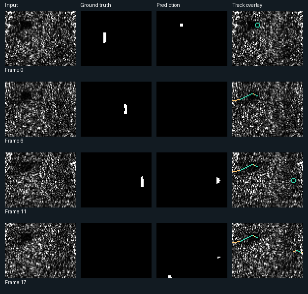

# 全 SAR 仿真数据集与神经网络检测

在 27 段独立 SAR 仿真序列上，因果时序卷积取得像素 IoU **0.486**、F1 **0.655**。相比单帧模型，IoU 提高 0.192。小尺寸高速组仍有 36 个漏检帧，是本轮仿真中最难的条件。

## 数据集

90 段序列，每段 18 帧、56×72 像素，共 1,620 帧。所有观察数据都经过复基带回波合成、距离压缩和逐脉冲反投影。每段保留成像可见掩膜、帧中心几何掩膜、时间戳及物理配置。仿真改变载频、带宽、散斑、轨迹、物体尺寸和噪声。独立测试的小尺寸高速组速度、高噪声组扰动幅度超出训练对应组的取值范围。

| 划分 | 序列 | 总帧数 | 可见阴影帧 |
|---|---:|---:|---:|
| 训练 | 45 | 810 | 550 |
| 验证 | 18 | 324 | 229 |
| 测试 | 27 | 486 | 323 |

场景及轨迹族跨划分互斥。六类条件均出现在验证集和测试集中。无目标序列的两个掩膜均为空，出画序列首帧有可见阴影，末帧无可见阴影。成像可见掩膜依据孔径遮挡比例及无阻挡参考功率下降生成。检测只读取观察图像。

## 模型与独立测试

单帧模型从当前帧提取多尺度对数功率特征。时序模型使用相同空间特征，加入过去最多五帧的局部最大值差、均值差、平滑变化和波动程度。两个模型均使用 24 个 3×3 卷积核、ReLU 激活和逐像素二分类头。时序模型有 1,993 个训练参数，推理无需未来帧。两个模型训练 24 轮，加入容易被混淆的低强度背景作为负样本。最终检测阈值由验证集选定，单帧为 0.70，时序为 0.80。

| 方法 | IoU | F1 | 匹配帧 | 误检区域 | 漏检帧 |
|---|---:|---:|---:|---:|---:|
| 强度阈值 | 0.199 | 0.332 | 208 | 2,698 | 115 |
| 帧间变化 | 0.255 | 0.406 | 155 | 1,825 | 168 |
| 单帧卷积 | 0.294 | 0.455 | 238 | 1,120 | 85 |
| 因果时序卷积 | 0.486 | 0.655 | 258 | 745 | 65 |

像素 IoU 与 F1 汇总测试集像素。目标级评估每帧至多匹配一个预测连通域，匹配阈值为 IoU 0.30。按 27 段场景做 2,000 次配对自助重采样，时序模型相对单帧模型的 IoU 增量 95% 区间为 **[0.144, 0.241]**。这个区间描述本仿真测试集上的场景波动。

| 时序模型测试条件 | 序列 | IoU | 匹配帧 | 误检区域 | 漏检帧 |
|---|---:|---:|---:|---:|---:|
| 纹理背景 | 5 | 0.620 | 86 | 88 | 4 |
| 静态杂波 | 5 | 0.578 | 82 | 95 | 8 |
| 高噪声 | 4 | 0.391 | 58 | 330 | 9 |
| 小尺寸高速 | 4 | 0.149 | 16 | 93 | 36 |
| 出画 | 4 | 0.421 | 16 | 54 | 8 |
| 无目标 | 5 | 0.000 | 0 | 85 | 0 |

无目标组的真值前景为空，由于仍存在预测前景，该组 IoU 为 0。高噪声组贡献了 330 个误检区域。时序模型虽然提高了分割质量，但平均阴影表观速度误差为 1.97 m/s，高于帧间变化基线的 1.43 m/s。分割增益尚未转化成速度估计增益。

## 复现材料

[运行指南](../../README.md) · [数据清单](dataset.json) · [标注统计](labels_by_scene.csv) · [完整指标](metrics.csv) · [按条件指标](metrics_by_condition.csv) · [逐场景指标](metrics_by_scene.csv) · [配对区间](iou_intervals.json) · [时序权重](models/causal_temporal.npz)
