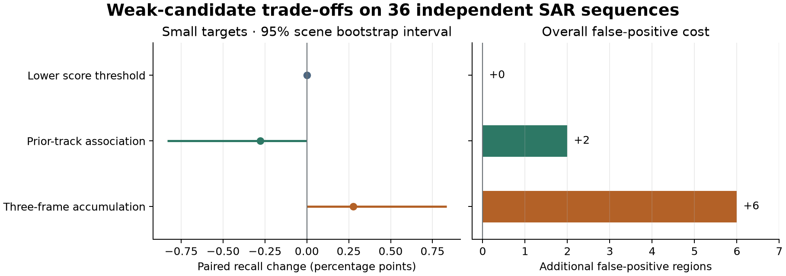

# 视频 SAR 小阴影的跨帧弱候选比较

**三帧累积保留为研究配置。** 在独立测试中，它把小目标召回从 59.72% 提高到 60.00%，在 360 个小目标帧中多匹配 1 帧。无目标场景仍为 29 次虚警，总体虚警多 6 次，查准率由 76.57% 降至 75.73%。本轮没有新配置达到采用标准，正式评测继续沿用原配置。

## 实验设置

上一轮有 47 个小目标帧的联合分割未匹配，但最高分中心框在阈值前满足 IoU ≥ 0.50。其中 34 帧在此前三帧内已有分割命中。这个基于真值回查的结果用于提出假设，本轮以新场景验证跨帧关联的实际收益。[中心候选实验](../center-study/report.md)

固定上一轮联合 U-Net 的权重和分割操作点，复用 24 段验证序列。新测试由种子 101661 生成 36 段、720 帧，其中 18 段小目标、9 段正常目标和 9 段无目标。纯回波设定为 600 MHz、成像后 25 dB、61／91 脉冲等量，统一按原始 64×80 网格目标级 IoU ≥ 0.50 评分。[冻结协议](../../runs/trajectory-study/protocol.json) · [测试清单](../../runs/trajectory-study/dataset/manifest.csv)

| 方法 | 本项目的实现 |
|---|---|
| 原联合分割 | 沿用上一轮冻结的分割阈值 0.10、最小连通域 12 像素与闭运算 |
| 仅低分框 | 以当前帧最高分中心框补空分割，或替换与当前框位置不符的分割。两种策略在验证集选择 |
| 轨迹关联 | 使用过去三帧内原分割的测量点预测当前位置，只有位移门槛内的当帧弱框可以补帧或纠正分割 |
| 跨帧累积 | 从前两帧各取最多四个局部峰值，在位移约束内寻找通往当前最高峰的路径，按三帧平均置信度筛选 |
| 低秩背景 | 对齐后用包含当前帧的短窗口做低秩投影，取当前帧的暗残差进行连通域检测 |

轨迹关联参考 ByteTrack 的高低分关联与 STCADeNet 的跨帧候选重打分。累积法参考检测前跟踪的思想，采用三帧候选路径。低秩对照使用短窗口投影实现，借鉴低秩法分离背景的思想。冻结开源 SMP FPN 和原背景差分同时参与复算。[ByteTrack 论文](https://arxiv.org/abs/2110.06864) · [ByteTrack 源码](https://github.com/ifzhang/ByteTrack) · [STCADeNet](https://www.sciencedirect.com/science/article/pii/S0957417425015039) · [Qin 等](https://doi.org/10.1109/JSTARS.2021.3104603) · [Yin 等](https://doi.org/10.3390/rs15061542)

验证配置先满足无目标虚警数不超过原联合分割、正常目标召回下降不超过 5 个百分点，其后优先满足总体查准率与召回均 ≥80%，再按小目标召回、F1 和虚警排序。锁定测试保留原采用门槛，并检查无目标虚警及正常目标是否守住原联合分割水平。相对原联合分割的小目标收益为正且满足后两项约束的验证首选可保留为研究配置。[验证全网格](../../runs/trajectory-study/validation_grid.csv) · [验证冻结记录](../../runs/trajectory-study/frozen_validation.json)

## 验证选择与锁定测试

验证集原联合分割、仅低分框、轨迹关联及跨帧累积的小目标召回分别为 65.00%、65.42%、65.83%、66.25%，无目标虚警均为 6 次。跨帧累积因此成为验证首选。冻结参数为候选路径平均置信度 0.32、相邻位移至多 2 像素、仅补空分割。低秩方案的验证配置均未满足约束，表里列出其探索对照结果。

| 方法 | 总体查准率 | 总体召回 | 小目标召回 | 正常目标召回 | 无目标虚警／180 帧 | 总体虚警 |
|---|---:|---:|---:|---:|---:|---:|
| 冻结 U-Net | 78.79% | 70.19% | 59.17% | 92.22% | 19 | 102 |
| 开源 SMP FPN | 74.67% | 63.33% | 49.72% | 90.56% | 12 | 116 |
| 冻结背景差分 | 31.19% | 25.19% | 6.11% | 63.33% | 54 | 300 |
| 原联合分割 | 76.57% | 72.04% | 59.72% | 96.67% | 29 | 119 |
| 仅低分框 | 76.57% | 72.04% | 59.72% | 96.67% | 29 | 119 |
| 轨迹关联 | 76.18% | 71.67% | 59.44% | 96.11% | 29 | 121 |
| 跨帧累积 | 75.73% | 72.22% | **60.00%** | 96.67% | 29 | 125 |
| 低秩背景 | 3.31% | 24.81% | 13.89% | 46.67% | 911 | 3,919 |

跨帧累积相对原联合分割的小目标召回差为 **+0.28 个百分点**。按 18 个小目标场景配对重采样 2,000 次，95% 区间为 **0.00 到 +0.83 个百分点**。13 帧 1–11 像素的阴影仍只匹配 2 帧。173 帧 12–23 像素的阴影从 74 帧增到 75 帧。[分组结果](../../runs/trajectory-study/metrics_by_group.csv) · [场景配对差](../../runs/trajectory-study/paired_summary.csv) · [面积分组](../../runs/trajectory-study/recall_by_shadow_area.csv)

累计补出 7 个当帧矩形。唯一恢复的匹配发生在 `trajectory-test-24` 第 15 帧，IoU 为 0.70。其余 6 个框的 IoU 均低于 0.50，属于有目标序列里的虚警。因此只看无目标虚警会高估这组改动的实用收益。测试支持将三帧累积留作可调用的研究版本，正式使用以整体查准率和召回的采用门槛为准。[逐帧复算](../../runs/trajectory-study/prediction_audit.json)



## 复现

```powershell
$env:OPENBLAS_NUM_THREADS = '1'
$env:OMP_NUM_THREADS = '4'
.\.venv\Scripts\python.exe -m videosar trajectory-study --output-dir runs\trajectory-study-repro
.\.venv\Scripts\python.exe -m videosar trajectory-detect --input runs\trajectory-study\dataset\trajectory-test-24 --profile deliverables\trajectory-study\retained.json --output-dir runs\trajectory-detect-demo
```

36 段测试数据哈希、5,760 条逐帧检测及 18 项配对差已独立核对。保留配置的命令行预测与存档逐字节一致，25 项自动测试通过。[保留配置](retained.json) · [证据包](../../runs/trajectory-study-evidence.zip)
